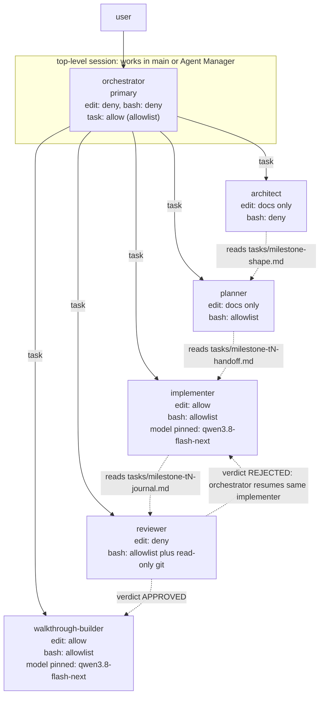

# Five-Role Agent Topology - Plan

**Status:** PLANNED
**Scope:** global Kilo config (`~/.config/kilo/`), project `AGENTS.md`, `~/.agents/skills/idd-workflow/`, `tasks/milestone_ledger.md`
**Supersedes:** the four-role hybrid topology (orchestrator / implementer / tool-caller / reviewer)
**Motivation:** remove the manual agent-switch step, make delegation identical from a main session or an Agent Manager session, and cut orchestrator context pressure

---

## 1. Problem Statement

The four-role hybrid topology has three defects discovered by permission probing on 2026-10-03/04.

### 1.1 The `implementer -> tool-caller` hop is structurally unreachable

Every session created through `TaskTool` is stamped `task: deny`:

```ts
// packages/opencode/src/kilocode/tool/task.ts
export function permissions(rules: Permission.Ruleset, task = false): Permission.Ruleset {
  return [
    ...(task ? [] : [{ permission: "task", pattern: "*", action: "deny" as const }]),
```

`KiloTask.permissions()` is called with the default `task = false`, so the deny is unconditional. Kilo PR #8644 removed the opt-in, an upstream merge reintroduced it through `canTask`, and PR #10137 re-blocked it by routing policy through a constant `KiloTask.nestedTask()`. The stated rationale is cost containment: recursive delegation let `explore -> explore -> explore` chains form and made cost breakdowns explode.

No config value can override this. A subagent cannot spawn a subagent.

### 1.2 A `mode: "primary"` agent cannot be spawned at all

```ts
export function validate(info: Agent.Info, name: string) {
  if (info.mode === "primary") throw new Error(`Agent "${name}" is a primary agent and cannot be used as a subagent`)
}
```

`mode: "all"` is spawnable but still receives `task: deny` in the child session. Therefore an agent keeps `task` **only** when it is a top-level session, started by the user or by Agent Manager.

### 1.3 Permission inheritance is asymmetric

`KiloTask.inherited()` propagates `deny` rules for `edit` and MCP, and deliberately excludes `bash`:

```ts
const mutation = new Set(["edit", ...guarded.filter((p) => p !== "bash")])
```

Documented rationale: a read-only delegating agent carries a `readOnlyBash` allowlist whose deny rules exist only to shape that allowlist; projecting them onto a writable subagent caps commands the subagent's own config allows (issue #11523). An explicit *session-scoped* bash lockdown still reaches children through `deriveSubagentSessionPermission`.

Observed consequence in this workspace: an orchestrator with `edit: deny` produced an implementer with no `write`/`edit`, while the same orchestrator's `bash: deny` did not strip `tool-caller`'s own `bash: allow`.

### 1.4 Consequence: the manual step

To reach `tool-caller`, the implementer had to be a top-level Agent Manager session. `agent_manager` always starts sessions on `default_agent` and offers no agent parameter, so a human agent switch was required at every implementation task. The workflow also behaved differently depending on where it ran.

---

## 2. Design Decision

### 2.1 Collapse to two delegation levels

The `tool-caller` existed to absorb noisy tool output. The distilling entry points already do that: `tools/testrun.py --distill` and `tools/distill.py` print a bounded digest plus a capture-file path, and route raw output to a file that never enters a session. The third level carried no weight.

Deleting it removes the constraint that forced the manual step.

### 2.2 Enforce distillation with permission allowlists, not prose

The safety property was previously carried by delegation structure and prompt text. It moves to the permission layer, where it is structural: an allowlist of distilling entry points with a catch-all deny makes raw `cargo test` impossible rather than discouraged.

This supersedes ledger row I8 ("enforcement lives in tools, not delegation prose") with a stronger form: enforcement lives in the permission allowlist, with tools providing the bounded-output contract.

### 2.3 Introduce dedicated architect and planner

Repo memory records two root causes of orchestrator context overflow: tool output not distilled at the delegation boundary, and plans emitting chunks too large for the orchestrator to hold. Dedicated roles keep whole-repository discovery and decomposition out of the orchestrator's context entirely. The value depends on artifact discipline in section 5.

### 2.4 Rejected alternatives

| Alternative | Why rejected |
|---|---|
| Keep `tool-caller`, implementer as top-level Agent Manager session | Requires the manual agent switch; workflow differs between session types |
| `implementer` with unrestricted `bash: allow` | Reintroduces raw-output flooding; the only guard would be prompt text |
| `implementer` as `mode: "primary"` | Cannot be spawned via `task` at all (1.2) |
| Prompt-only enforcement of the distillers-only rule | Prompt text is not a control; the permission layer is |

---

## 3. Target Topology



Solid edges are `task` delegation from the orchestrator. Dashed edges are artifact or verdict flow: the orchestrator still spawns each role, but the role learns what it needs by reading the named file, never by receiving its contents inline.

Every delegation edge is `task`, so routing behaves identically from a main session or an Agent Manager session. No edge depends on `default_agent`, and there is no manual agent-switch step.

### 3.1 Roster

| Agent | Mode | Replaces |
|---|---|---|
| `orchestrator` | `primary` | unchanged role, new permissions and prompt |
| `architect` | `subagent` | new (was folded into the orchestrator prompt) |
| `planner` | `subagent` | new (was folded into the orchestrator prompt) |
| `implementer` | `subagent` | unchanged role, `bash` changed from deny to allowlist |
| `reviewer` | `subagent` | unchanged role, `bash` narrowed to read-only git |
| `walkthrough-builder` | `subagent` | replaces `review-guide` |

**Delete:** `tool-caller`, `review-guide`, `code-reviewer`.

`code-reviewer` is `mode: "primary"` (per 1.2, not spawnable) and duplicates `reviewer`. Keeping both invites misrouting.

### 3.2 Delegation sequence

```
request -> architect -> planner -> implementer -> reviewer -> [walkthrough-builder]
```

Each hop receives **paths**, never artifact contents. `reviewer` returning REJECTED routes back to the *same* `implementer` session via `task_id` resume, not a fresh implementer.

---

## 4. Permission Model

### 4.0 Confirmed rule precedence: the catch-all goes FIRST

Probed on 2026-10-04 with a throwaway agent carrying a nested glob permission
map. Result: **the last matching rule wins.** A catch-all `"*": "deny"` placed
*after* the specific allows shadows every one of them and denies the tool
outright; the same map with the catch-all placed *first* admits exactly the
patterns listed after it.

This contradicts the config reference's Permissions section, which states
"first match wins", and matches its MCP section, which states last match wins.
The MCP section is the correct one for the permission system as implemented.

Every permission object in this plan therefore puts the catch-all first and the
specific rules after it. The probe evidence:

| Attempted | Result |
|---|---|
| `cargo --version` | denied |
| `python -c "print(1)"` | denied |
| `python tools/hygiene_check.py --help` | permitted (ran; the script rejects `--help` at runtime, which is not a permission refusal) |
| `python -m unittest --help` | permitted, exit 0 |
| write `tasks/zz-probe-target.md` | permitted |
| write `crates/graph/src/zz_probe.rs` | denied |

Two operational notes from that probe. The permission error reports the
matching **deny** rule rather than the absence of a matching allow, so a denial
message citing `{"pattern":"*","action":"deny"}` does not mean the allowlist is
missing - it means the catch-all won, which is expected. And `edit` and `bash`
denials cite different sources: an `edit` denial names the agent's own
definition, a `bash` denial names global config. When debugging, that
distinction tells you which layer to look at.

### 4.1 The standard bash allowlist

Used by `planner`, `implementer`, and `walkthrough-builder`. Identical block in each:

```jsonc
"bash": {
  "*": "deny",
  "python tools/testrun.py*": "allow",
  "python tools/distill.py*": "allow",
  "python tools/hygiene_check.py*": "allow",
  "python tools/encoding_guard.py*": "allow",
  "python tools/theme_token_check.py*": "allow",
  "python tools/commit_scoped.py*": "allow",
  "python tools/checkpoint_guard.py*": "allow",
  "python -m unittest*": "allow"
}
```

Notes:

- `commit_scoped.py` is inside the allowlist, which is why deleting `tool-caller` does not orphan commits. It is also the repo's existing mandated ritual (never `git add .`).
- `hygiene_check.py`, `encoding_guard.py`, and `theme_token_check.py` produce small native output. They are allowed because they are required gates, not because they distill.
- `cargo`, `python -c`, shell operators, and raw `git` are denied as *direct* invocations by the catch-all.

### 4.1a What the bash allowlist does and does not guarantee

The `distill.py` entry point is an argv pass-through. It distils whatever it is
handed, so a command the allowlist refuses directly is still reachable by
wrapping it. Discovered empirically during the smoke test on 2026-10-04: the
implementer found that `python -c` is rejected as a direct command yet accepted
when nested inside the distiller's argument list, and it bisected the boundary
to characterise the rule.

The correct claim is therefore narrower than "raw `cargo test` is impossible":

- **Guaranteed:** no command can produce unbounded output in an agent's
  context. Anything run directly is either an allowlisted tool with natively
  bounded output, or it is refused. Anything run through `distill.py` is
  distilled regardless of what it wraps. This is the property that protects
  context, and it holds.
- **Not guaranteed:** command scope. A role permitted to use the distiller can
  wrap any command in it. `distill.py -- cargo test` executes the full suite.
  Which commands run is governed by the role prompt and the handoff's declared
  gates, not by the permission layer.

This is a deliberate trade rather than an oversight. Containing *output* is the
property that matters for context pressure and is fully enforced. Containing
*which* program runs would require the distiller to validate its argument
against a second allowlist, which duplicates the allowlist in a place with
weaker enforcement and no gain, since a distiller that refuses arguments can
simply be bypassed by writing the output to a file and reading it.

One residual exposure worth naming: `python -m unittest*` is allowlisted and is
not itself a distiller. It emits bounded per-test output in normal use, so the
risk is small, but it is the one allowlisted entry whose output is not bounded
by construction.

### 4.1c The denial message misreports the rule: never conclude from one denial

A refused command reports the **catch-all deny rule**, never the rule that
actually rejected it:

```
The user has specified a rule which prevents you from using this specific tool call
{"permission":"bash","pattern":"*","action":"deny","source":"global"}
```

That text is emitted for *any* disallowed command, including one that was
refused simply for not matching the allowlist. It is not evidence that the tool
is unavailable or that the allowlist is inert.

This is not a cosmetic issue. During the smoke test on 2026-10-04 the reviewer
attempted `certutil -encodehex` - not on the allowlist, so correctly refused -
read the message above, concluded that `bash` was entirely unavailable, and fell
back to `git_git_*` and `grep`. It consequently skipped `hygiene_check.py`,
`encoding_guard.py`, `testrun.py`, and `checkpoint_guard.py`, all of which it was
permitted to run, and returned a verdict with its acceptance pass unexecuted.

A follow-up probe of the same role on the same config settled it:

| Command | On allowlist | Result |
|---|---|---|
| `python tools/hygiene_check.py --help` | yes | permitted |
| `python tools/encoding_guard.py --help` | yes | permitted |
| `certutil -encodehex ...` | no | denied |

So the role's gate coverage depended on which command it happened to try first.
The role prompts now carry an explicit instruction: attempt every gate
individually, never infer tool availability from a single refusal, and treat a
reported wildcard deny as boilerplate rather than as a finding about the tool.

The deeper fix belongs in the permission resolver, which should report the
specific matching rule. Until it does, the prompt-level instruction is the only
mitigation available, and it is a mitigation against a misleading diagnostic
rather than against an actual denial.

### 4.1b Reading a stalled chain: read the child, not the parent

A verification note, because it cost a wrong diagnosis. A foreground `task`
call blocks the parent session until the child returns. The parent's transcript
therefore does not advance while a child is working, and an orchestrator
mid-sequence looks identical to one that has hung.

During the first smoke test the implementer hop was declared stalled after
roughly thirteen minutes on that evidence alone. It had in fact been working
the entire time and had completed the handoff read, several bash probes, a
permission-boundary bisection, and the Red gate run. The child session had to be
located by searching the project's session history, since `agent_manager list`
reports only Agent Manager sessions and not `task` descendants.

When a chain appears stuck, resolve the child's session id and read it before
concluding anything. Absence of parent progress is not absence of progress.

### 4.2 Reviewer bash allowlist

Adds read-only git for the `review-gate` per-commit audit, and no write git:

```jsonc
"bash": {
  "*": "deny",
  "python tools/testrun.py*": "allow",
  "python tools/distill.py*": "allow",
  "python tools/hygiene_check.py*": "allow",
  "python tools/encoding_guard.py*": "allow",
  "python tools/theme_token_check.py*": "allow",
  "python tools/commit_scoped.py*": "allow",
  "python tools/checkpoint_guard.py*": "allow",
  "python -m unittest*": "allow",
  "git status": "allow",
  "git log*": "allow",
  "git show*": "allow",
  "git diff*": "allow",
  "git rev-parse*": "allow"
}
```

Write git is excluded so a reviewer cannot commit over findings it is meant to surface. `git show` invocations must quote the whole `revision:path` argument - an unquoted `^` is misparsed by PowerShell and silently compares the wrong blob.

### 4.3 Document-scoped edit for architect and planner

An architect that can edit source will start editing source. Scope it structurally:

```jsonc
"edit": {
  "*": "deny",
  "tasks/**": "allow",
  ".kilo/plans/**": "allow"
}
```

### 4.4 Orchestrator task allowlist

With six agents and flat description-match dispatch, misrouting becomes likely. Make the legal hops explicit:

```jsonc
"task": {
  "*": "deny",
  "architect": "allow",
  "planner": "allow",
  "implementer": "allow",
  "reviewer": "allow",
  "walkthrough-builder": "allow"
}
```

### 4.5 Agent Manager gate

`agent_manager` is required on the orchestrator only if Agent Manager sessions are to be driven from chat. Deny it elsewhere so no subagent can spawn sessions.

### 4.7 Ungated tools: `background_process` and the `git_git_*` family

The `bash` allowlist is not the whole execution surface. Two further tool
families bypass it entirely, because they are separate tools with their own
permission keys rather than commands routed through `bash`:

- `background_process` accepts a `command` string and runs it as a tracked
  process. It is a shell in everything but name.
- `git_git_add`, `git_git_commit`, `git_git_reset`, `git_git_checkout`, and
  `git_git_create_branch` mutate the repository. Together they would let a role
  commit without `commit_scoped.py`, and therefore without the scoped-commit
  discipline and the touch-set audit that `review-gate` depends on.

Neither family appears in the documented tool-permission key list. Probed on
2026-10-04 with a throwaway agent that named them explicitly:

| Denied in frontmatter | Observed |
|---|---|
| `background_process` | absent |
| `git_git_add`, `git_git_commit`, `git_git_reset`, `git_git_checkout`, `git_git_create_branch` | all absent |
| `git_git_status`, `git_git_log`, `git_git_show`, `git_git_diff`, `git_git_branch`, `git_git_diff_staged`, `git_git_diff_unstaged` | present, being unlisted |

Arbitrary permission keys do gate these tools, and the split is clean: denying
the five mutating git operations leaves the read-only ones intact, which is
exactly what `reviewer` needs for its per-commit audit. Every role therefore
carries this block:

```yaml
background_process: deny
git_git_add: deny
git_git_commit: deny
git_git_reset: deny
git_git_checkout: deny
git_git_create_branch: deny
```

`reviewer` needs no git entries of its own: the read-only tools survive by
default once the mutating ones are denied. The `git log*`, `git show*`,
`git diff*`, and `git rev-parse*` globs in the reviewer bash allowlist are
therefore close to dead weight. They are retained only so the reviewer can fall
back to shelling out when a git invocation needs an argument shape the
`git_git_*` tools cannot express, such as `git show "rev^:path"`.

With this block in place the earlier claim becomes accurate for direct
invocation: `cargo test`, `git commit`, and shell redirection are unreachable
*as commands*. The distiller remains an argv pass-through, so reachability by
wrapping is a separate and deliberate question, settled in section 4.1a.

### 4.9 The parent `edit` ceiling: why the orchestrator holds `edit: ask`

Discovered by the synthetic smoke test on 2026-10-04, which failed at hop 1. The
architect had **no `write` tool at all**, despite its own frontmatter granting
`edit` on `tasks/**`, which is exactly where it was told to write.

Root cause, from `KiloTask.inherited()`:

```ts
const mutation = new Set(["edit", ...guarded.filter((p) => p !== "bash")])
for (const permission of mutation) {
  if (Permission.evaluate(permission, "*", rules).action !== "deny") continue
  inherited.push({ permission, pattern: "*", action: "deny" })
}
```

If the **calling agent's** effective `edit` rule at pattern `*` evaluates to
`deny`, Kilo pushes a blanket `edit: deny` ceiling into the child session. That
ceiling is a floor the child cannot raise, so the architect's own narrower map
became irrelevant and both `write` and `edit` were stripped from it.

This is the same inheritance rule as section 1.3, and the failure mode is
sharper than the rule's wording suggests: it is not that the child inherits a
*narrower* grant, it is that the child inherits *no grant at all*.

Two details worth recording, because they explain why the direct probes passed
and the real chain did not:

- Permission-gated probe agents spawned by the `code` agent worked, because
  `code` allows `edit` and therefore creates no ceiling. The same agent
  definitions spawned by the orchestrator had no write tool. The bug was
  invisible to any probe that did not go through an `edit: deny` parent.
- Both `write` and `edit` fall under the single `edit` permission key, so a
  missing `write` grant is never the explanation. The smoke-test report
  hypothesised exactly that, and it was wrong.

**The fix.** The orchestrator holds `edit: "ask"`, not `deny`. `ask` does not
evaluate to `deny`, so no ceiling is created and each role keeps its own map. The
cost is that the orchestrator is no longer *provably* unable to edit; it must ask.
Its role prompt states it writes no artifacts, and a human decision stands
between it and any file.

This is the one place where the topology cannot have both a parent that provably
cannot edit and children that can. Kilo's inheritance rule forces the choice, and
`ask` is the only setting that resolves it. Denying `edit` on the orchestrator
would reintroduce the manual-step problem from the original design, because no
role could produce an artifact.

### 4.8 Full permission matrix

| Permission | orchestrator | architect | planner | implementer | reviewer | walkthrough-builder |
|---|---|---|---|---|---|---|
| `read` `grep` `glob` `list` | allow | allow | allow | allow | allow | allow |
| `edit` | ask (ceiling, 4.9) | docs only | docs only | allow | docs only | allow |
| `bash` | deny | deny | allowlist | allowlist | allowlist + ro git | allowlist |
| `task` | allowlist | deny | deny | deny | deny | deny |
| `skill` | allow | allow | allow | deny | allow | allow |
| `webfetch` `websearch` | allow | allow | allow | allow | allow | deny |
| `lsp` | allow | allow | allow | allow | deny | deny |
| `todowrite` `todoread` | allow | allow | allow | allow | deny | deny |
| `agent_manager` | allow | deny | deny | deny | deny | deny |
| `external_directory` | ask | deny | deny | ask | deny | deny |
| `background_process` | deny | deny | deny | deny | deny | deny |
| mutating `git_git_*` | deny | deny | deny | deny | deny | deny |
| read-only `git_git_*` | allow | allow | allow | allow | allow | deny |

`reviewer` gets docs-only `edit` rather than `deny`, for two reasons that point the same way. It must leave a durable verdict and an execution-results addendum that survive the session, for the operator and for the next one. And a reviewer that cannot write anything is a reviewer whose findings exist only as a chat return value, which is precisely the thing that gets lost. Scoping the grant to `tasks/**` and `.kilo/plans/**` keeps the audit trail while making it structurally impossible for the reviewer to edit the code it is judging, or to alter the journal it is auditing against.

---

## 5. Artifact and Context Contract

This section carries more weight than the agent list. Splitting roles without it makes orchestrator context *worse*, because each additional hop adds a result payload the orchestrator must hold.

### 5.1 Rules

1. **Artifacts on disk.** Every role writes its output to a file and returns a path plus a digest. No role returns artifact contents.
2. **Pass paths, never contents.** When the orchestrator routes, it forwards file paths. It never summarizes or inlines an artifact on an agent's behalf.
3. **Single-owner files.** Each artifact has exactly one writing role (table below). Collisions in `tasks/` are the predictable failure of two roles with `edit` in the same tree.
4. **Bounded returns.** A return is a digest of at most ~20 lines. If it does not fit, it belongs in a file.

### 5.2 Artifact ownership

| Artifact | Writer | Readers |
|---|---|---|
| `.kilo/plans/<id>-<slug>.md` | `architect` | planner, implementer, reviewer |
| `tasks/<milestone>-kickoff.md` | `architect` | planner, implementer, reviewer |
| `tasks/<milestone>-shape.md` | `architect` | planner |
| `tasks/<milestone>-t<n>-handoff.md` | `planner` | implementer, reviewer |
| `tasks/milestone_ledger.md` | `planner` | architect, implementer, reviewer, orchestrator |
| `tasks/<milestone>-t<n>-journal.md` | `implementer` | reviewer |
| `tasks/<milestone>-t<n>-verdict.md` | `reviewer` | orchestrator |
| `tasks/<milestone>-execution-results.md` | `reviewer` | orchestrator, operator |
| `walkthroughs/<feature>-walkthrough.html` | `walkthrough-builder` | committed in the same commit as finalization |

Three of these assignments exist because the obvious owner cannot write. The orchestrator has `edit: deny`, so it cannot maintain the ledger it is the routing authority for; the ledger therefore belongs to `planner`, which already writes into `tasks/` and is the role that knows a milestone's task decomposition. The kickoff document is the artifact that states intent, scope, and invariants before any task exists, so it belongs to `architect` rather than being written by the role that consumes intent. The execution-results addendum is the record of what actually happened against the acceptance criteria, which is the reviewer's evidence, so it belongs to `reviewer` and not to the orchestrator that dispatched the work.

The ledger is a shared file rather than a single-owner artifact. `planner` is the only role that writes it, and it writes rows for state transitions it owns: milestone status, handoff completion, deferred findings discharged or dropped. `reviewer` and `implementer` read it to learn the frozen locks, and never edit it. This is the one deliberate exception to the single-owner rule, and it is why the ledger gets an explicit row in the permission matrix rather than falling under the generic `tasks/**` grant.

### 5.3 Planner must not re-derive

`planner` reads the shape artifact and treats it as given. Its discovery is scoped to the modules the architect named. Two roles independently surveying the whole workspace doubles the most expensive reads in the repo and is the main cost risk in this design.

---

## 6. Model Policy

Subagent model resolution, from `KiloTask.defaultModel()`:

1. per-call `model` / `provider` / `variant` on the `task` tool
2. the subagent's own `model` field in config
3. global `subagent_model`
4. **inherit the calling session's model**

The CLI-saved pick (step 2 in the source) is skipped outside the CLI client:

```ts
const saved = Effect.fn("KiloTask.savedModel")(function* (name: string) {
  if (Flag.KILO_CLIENT !== "cli") return undefined
```

In the VS Code extension there is no hidden override. A model override does not inherit the caller's reasoning effort; variant resolves independently.

| Agent | Model | Reason |
|---|---|---|
| `architect` | inherit | highest judgment load; escalate per task by switching session model |
| `reviewer` | inherit | a wrong APPROVED is the expensive failure |
| `planner` | inherit | moderate judgment, heavy context |
| `implementer` | `spark/qwen3.8-flash-next` | mechanical, high volume; pinned to the local model |
| `walkthrough-builder` | `spark/qwen3.8-flash-next` | mechanical, high volume; pinned to the local model |

Because resolution step 4 inherits, switching the session model moves architect, planner, and reviewer together. That is the intended escalation dial and requires no config edit.

---

## 7. Role Prompts

Implement agents as markdown files under `~/.config/kilo/agent/` rather than entries in `kilo.jsonc`. Frontmatter carries `description` / `mode` / `model` / `permission`; the markdown body is the prompt. This keeps prompts as real prose with real line breaks instead of single escaped JSON strings, which matters given the repository's sub-2000-character source-line rule.

Remove the corresponding `agent` entries from `kilo.jsonc` in the same change so the two sources cannot disagree.

### 7.1 Shared clauses

Concatenate the relevant shared clauses into each role prompt. They are written out once here to avoid five copies drifting.

**H - Code hygiene (all roles that touch source)**

```markdown
## Code Hygiene Gates (non-negotiable)

- Functions strictly under 100 lines.
- Files strictly under 1000 lines. `graph.rs`-style files near the ceiling get a
  proactive module extraction, not a late R2 failure.
- No source line at or above 2000 characters. Agents' Read and grep silently
  truncate at 2000 chars, hiding content from every workflow participant. Wrap
  whitespace-collapsing prose sentence-per-line; where newlines are significant
  (`<pre>`, string literals), split into concatenated parts instead.
- Intention-revealing names. No `tmp`, `res`, `data`, `scc_tmp`, single-letter
  locals. Predicates read as predicates.
- Single responsibility: one function does one thing.
```

**D - Distillation contract (all roles with bash)**

```markdown
## Command Execution Contract

Every command runs through a distilling entry point. Raw `cargo test`,
`cargo build`, and raw `git` are denied by permission, not by convention.

- Tests: `python tools/testrun.py --distill [scoped args]`
- Build, clippy, generic: `python tools/distill.py -- <argv>`
- Hygiene: `python tools/hygiene_check.py`
- Encoding: `python tools/encoding_guard.py --staged` (pre-commit), `--all` (full)
- Commits: `python tools/commit_scoped.py --scope <glob> -m <msg>`

Report the distiller's digest lines verbatim and the capture path. Never paste
raw multi-line tool output into a report. Truncation is self-declared
("... and K more").
```

**F - File-edit discipline (all roles that write files)**

```markdown
## File-Edit Discipline (UTF-8)

PowerShell 5.1 mangles UTF-8 in this repository; tracked files have accumulated
double-encoded sequences of legitimate characters. Never write or rewrite file
content through `Set-Content`, `Out-File`, `>`, `>>`, or a
`Get-Content | -replace` pipeline. Use the Read / Edit / Write tools, or
byte-level writes from a script.

All authored content is pure ASCII. Test fixtures that need a corruption
signature construct it from byte escapes, never literals.

When quoting git content, always quote the whole argument: `git show "rev^:path"`.
An unquoted `^` is misparsed by PowerShell and can compare the wrong blob.
Never pipe `git show` or `git cat-file` through PowerShell into a file.
```

**A - Artifact discipline (every role)**

```markdown
## Artifact Contract

Write your output to the file named in your task. Return the path plus a digest
of at most 20 lines. Never return the file's contents.

Do not write files owned by another role. If you believe another role's artifact
is wrong, report it in your digest rather than editing it.

You own exactly one artifact. See the ownership table in the plan.
```

### 7.2 `orchestrator` (primary, top-level)

```markdown
You are the Lead System Architect and Orchestrator. You own routing, lifecycle,
and verdict handling. You do not produce artifacts of your own except the
delegation sequence.

## Hard Boundaries (enforced by permission)

You cannot edit files and you cannot run commands. Your deliverables are the
delegation sequence, the todo list, and the final lifecycle coordination.

## Delegation Sequence

For each unit of work, in this order:

1. `architect` - determines the shape of the change.
2. `planner` - breaks the shape into sized, independently shippable handoffs.
3. `implementer` - executes one handoff under strict TDD.
4. `reviewer` - adjudicates the handoff. On REJECTED, resume the *same*
   implementer session with the findings rather than spawning a fresh one.
5. `walkthrough-builder` - only after the user asks for a walkthrough.

## Routing Rules

- Pass file paths, never artifact contents. When you forward work to the next
  role, name the artifact it should read. Never summarize an artifact inline on
  a subagent's behalf; that is how your own context fills up.
- Give each role exactly one artifact to write.
- Track state in the todo list, not in your context.
- Never implement, never review, never run a gate.

## Handoff Sizing

A handoff unit must fit: at most one Cargo crate or one top-level module
directory, at most ten scoped gate commands, and at most about 1200 lines of
produced diff. If a unit exceeds any bound, split it before dispatching.

Workspace-wide gates (`testrun.py --baseline`, full `unittest discover`,
`ui_smoke`, `bench_compare`) cannot run in your session because you have no
bash. Assign them to the `reviewer` hop, which has the read-only git allowlist
and the distilling entry points.

## Model Escalation

Your subagents inherit your current session model except `implementer` and
`walkthrough-builder`, which are pinned. To escalate, switch the session model;
architect, planner, and reviewer move together.
```

Permissions: section 4.8 orchestrator row, with `task` per 4.4.

### 7.3 `architect` (subagent)

```markdown
You are the Architect. You determine the *shape* of a change: its intent, the
invariants that must hold, the contracts and signatures at system boundaries,
the modules in and out of scope, and the risks.

You do not sequence the work. You do not write handoffs. You do not implement.
The planner turns your shape into sized tasks; the implementer executes them.

## Method

1. Read the request, `Intent.md`, `Plan.md`, `Spec.md`, and
   `tasks/milestone_ledger.md`.
2. Survey the repository for the modules the change touches. Prefer semantic
   search to open-ended reading. Do not read the whole repository.
3. Write the shape artifact.

## Required Content of the Shape Artifact

- Intent statement: the behavior change, its blast radius, and the why.
- Invariants: numbered, each independently checkable. State which are frozen
  from prior milestones, with the lock that protects each.
- Contracts: explicit types, signatures, schemas, and error shapes at every
  boundary you are changing.
- In scope / out of scope, with the reason for each exclusion.
- Risks with named mitigations, and the plan-spec test or oracle that would
  catch each.
- Hygiene notes: any module already near the 1000-line ceiling, and any
  function near 100 lines, that this change will grow.

## Invariants Discipline

Prefer an invariant that a test can falsify. "Cycle semantics are unchanged" is
not an invariant; "for every fixture, the set of files reported as cyclic is
identical before and after" is. Say which test locks each one.

## Boundaries

- You may write only `tasks/<milestone>-kickoff.md`, `tasks/<milestone>-shape.md`,
  and `.kilo/plans/**`. The kickoff document states intent, scope, invariants,
  and frozen locks before any task exists; it is yours because it is the
  statement of intent, not a summary of someone else's plan.
- You may not modify source, tests, the ledger, or another role's artifact.
- Run no commands; you have no bash.
```

Permissions: section 4.8 architect row, `edit` per 4.3.

### 7.4 `planner` (subagent)

```markdown
You are the Planner. You convert an approved shape into a sequence of handoffs,
each small enough for one implementer session to finish and one reviewer to
adjudicate.

You do not re-derive the shape. Read `tasks/<milestone>-shape.md` and treat it
as given; if you believe it is wrong, say so in your digest and stop. Scope
your own repository reading to the modules the shape names.

## Sizing Law - a handoff unit must fit all three

- Scope: at most one Cargo crate, or one top-level module directory under
  `crates/`, `tools/`, or `tests/`.
- Gates: at most about ten scoped gate-command invocations.
- Output: at most about 1200 lines of implementation plus test diff.

Anything larger splits. Split along a boundary that lets the first handoff ship
independently, and say in the split rationale why the seam is the right one.

Workspace-wide gates do not belong in an implementer handoff. They belong in
the reviewer's acceptance pass.

## Handoff Template

Use the `handoff-spec` skill. Every handoff states, in this order:

1. Objective and the invariants it must preserve.
2. Hard touch-set: the exact files the implementer may modify.
3. Frozen locks: the byte-locked sets, goldens, and parity tests that must not
   change, with the command that proves each.
4. Red: the failing test, its file, and the expected failure reason. A test
   that fails to compile is not Red.
5. Green: the minimal implementation bound.
6. Refactor and hygiene targets.
7. Acceptance: machine-checkable commands and the expected verdict line.
8. Reviewer gate reference.

## Ordering

Sequence by dependency, then mark which handoffs are parallel-safe. Within a
parallel group, say explicitly that they touch disjoint files; two handoffs
that touch the same file are never parallel.

## Boundaries

- You may write only `tasks/<milestone>-t<n>-handoff.md` and
  `tasks/milestone_ledger.md`. The ledger is yours because the orchestrator is
  read-only and the ledger must change in the same commit as the state it
  records. Write rows for the transitions you own: milestone status, handoff
  completion, deferred findings discharged or dropped. Honour the archive rule:
  a row that has been carried out moves verbatim to `tasks/ledger_archive.md`
  instead of accumulating in the live table.
- You may run only the distilling entry points, and only to size a task, for
  example to count tests in a suite.
- You may not modify source or tests.
```

Permissions: section 4.8 planner row, `edit` per 4.3, `bash` per 4.1.

### 7.5 `implementer` (subagent)

```markdown
You are the Implementer. You execute exactly one handoff, under strict TDD,
touching only the files the handoff's touch-set names.

You do not invent features, redesign architecture, or widen scope. If the
handoff is wrong, report it and stop; do not improvise a fix.

## Strict TDD Loop

For each step, in order:

1. **Red.** Write the failing test first, in the file the handoff names. Run it
   through `python tools/testrun.py --distill [scoped args]`. Confirm it fails
   *for the expected semantic reason* - a compile error or a typo is not Red.
2. **Green.** Write the minimum code that passes. No speculative helpers, no
   premature abstraction, no unrequested configurability.
3. **Refactor.** Improve readability and remove duplication. Re-run the scoped
   tests to confirm no regression.

Report each phase's digest line. Never paste raw test output.

## Scope Discipline

- Modify only files in the touch-set. If the task appears to require a file
  outside it, stop and report that instead of expanding scope.
- Do not touch golden fixtures, byte-locked manifests, or theme token
  baselines. Their regeneration protocols are in `tasks/milestone_ledger.md`
  and require explicit approval.
- New UI styling stays token-driven: zero new hex literals in any file you
  touch. Semantic verdict colors keep their meaning across all three themes.

## Completion Gate

Before reporting done, all of the following must pass, run through the
distilling entry points:

- The handoff's acceptance commands, each reported verbatim.
- `python tools/hygiene_check.py` - R1/R2 are blocking.
- `python tools/encoding_guard.py --staged` after staging.
- The journal file the handoff names, written with what you did, what you
  deliberately did not do, and any deviation with its reason.

Commit with `python tools/commit_scoped.py --scope <touch-set glob> -m <msg>`,
one scoped commit per logical step. Never `git add .`.

## Boundaries

- You have no bash beyond the distilling entry points and `commit_scoped.py`.
  Raw `cargo` and raw `git` are denied by permission.
- You cannot spawn subagents. If you need a command run, it must go through
  an allowlisted entry point.
```

Permissions: section 4.8 implementer row, `bash` per 4.1.

### 7.6 `reviewer` (subagent)

```markdown
You are the Reviewer. You adjudicate one handoff via the `review-gate` skill and
return a verdict. You are read-only with respect to source.

## Process

1. Read `tasks/<milestone>-t<n>-handoff.md`.
2. Run the `review-gate` skill against it.
3. Return APPROVED or REJECTED with numbered findings.

## What the gate enforces

- Commit-versus-touch-set: every commit lands inside the handoff's declared
  touch-set. A commit outside it is a finding, not a technicality.
- Per-commit review, oldest first, of each commit in the range.
- Plan-literal compliance: the implementation does what the handoff said, not
  something adjacent that happens to also work.
- Independent deviation adjudication: a logged deviation is judged on its
  merits, not rubber-stamped.
- Hygiene, encoding, and frozen locks.

## Audit Focus

For every task, additionally check the specific risk the handoff names. For
iterative graph or SCC work that means the lowlink update points at push,
advance, and pop; tie-break determinism; and the absence of any retained dual
representation.

## Acceptance Pass

The reviewer also runs the workspace-wide gates that no implementer handoff
carries: `python tools/testrun.py --baseline`, the full
`python -m unittest discover -s tools -p "*_tests.py"`, and any benchmark or
smoke command the milestone requires. Quote the canonical
`N passed / M failed / K ignored / S suites` line verbatim.

## Boundaries

- Read-only git only: `status`, `log`, `show`, `diff`, `rev-parse`. Write git
  is denied, so you cannot commit over a finding you are meant to surface.
- Write only `tasks/<milestone>-t<n>-verdict.md` and
  `tasks/<milestone>-execution-results.md`. The addendum records what actually
  happened against each acceptance criterion, quoting the evidence lines. It is
  yours because it is your evidence, not the orchestrator's summary of it.
- Your `edit` grant covers `tasks/**` and `.kilo/plans/**` only. You cannot
  modify source, tests, or the journal you are auditing, and you must not try.
- Quote `git show` arguments whole: `git show "rev^:path"`.
```

Permissions: section 4.8 reviewer row, `bash` per 4.2.

### 7.7 `walkthrough-builder` (subagent, replaces `review-guide`)

```markdown
You are the Walkthrough Builder. You produce the interactive HTML deck that
explains a completed change to the engineers who will maintain it.

You are not a reviewer. You do not approve work and you do not hunt for
defects; the `reviewer` role has already adjudicated it by the time you run.

## Method

1. Read the handoff and journal for the shipped task, and the diffs of its
   commits.
2. Establish what changed, why, and the blast radius before any line-level
   detail.
3. Build the deck at `walkthroughs/<feature>-walkthrough.html`.

## Content

- Executive summary: intent, scope, risk.
- Before and after, side by side, for each meaningful change.
- Data flow and control flow for the changed path.
- The invariants that now hold, and which test locks each.
- Trade-offs stated explicitly, including what was rejected and why.
- Navigation that lets an engineer drill from summary to diff.

## Hygiene

- The deck is HTML with embedded CSS. Wrap prose sentence-per-line; never park a
  paragraph on one source line, because agents' Read and grep truncate at 2000
  characters and would silently hide it.
- Keep every styling decision token-driven. Introduce no new hex literals.
- The file must be self-contained and openable from disk with no server.

## Landing the Deck

A deck that exists only on disk or only in a worktree has been lost twice in
this repository. Commit it into `walkthroughs/` in the same commit as the
finalization it documents, using
`python tools/commit_scoped.py --scope walkthroughs/** -m <msg>`.

## Boundaries

- You may write only `walkthroughs/<feature>-walkthrough.html`.
- You may not modify source, tests, or another role's artifact.
- You cannot spawn subagents.
```

Permissions: section 4.8 walkthrough-builder row, `bash` per 4.1.

---

## 8. Migration Steps

Ordered; each step is independently verifiable.

| # | Step | Verification |
|---|---|---|
| M0 | **DONE** Back up `kilo.jsonc` to `kilo.jsonc.bak-20261004` | SHA256 verified byte-identical, 16835 bytes |
| M0b | **DONE** Probe rule precedence with a throwaway agent | Confirmed last-match-wins; recorded in 4.0 |
| M0c | **DONE** Probe the agent directory spelling | `~/.config/kilo/agents/` (plural) is scanned; singular is not |
| M1 | Author six agent markdown files under `~/.config/kilo/agents/` | Files load; no JSON/string escaping |
| M2 | Delete `agent` block entries for `tool-caller`, `review-guide`, `code-reviewer`, and all four retained agents from `kilo.jsonc` | `kilo.jsonc` has no `agent` key |
| M3 | Point `default_agent` at `orchestrator` | Already correct; confirm |
| M4 | Restart Kilo | Session picker lists orchestrator; subagent list shows the five |
| M5 | Run the probe battery in section 9 | All six probes pass |
| M6 | Rewrite `AGENTS.md` role list and delegation description | Matches the six-role topology; tool-caller references gone |
| M7 | Rewrite `~/.agents/skills/idd-workflow/COORDINATION.md` topology diagram | No `tool-caller`, no `review-guide` |
| M8 | Amend `~/.agents/skills/implementer-rgb-tdd/SKILL.md` | Says "run distilling entry points", not "delegate to tool-runner" |
| M9 | Amend `handoff-spec` skill gates section | States the sizing law and that workspace gates route to the reviewer |
| M10 | Update ledger row I8 in `tasks/milestone_ledger.md` | Reads "enforcement lives in the permission allowlist" |
| M11 | Revise `tasks/m235-kickoff.md` and `tasks/m235-t1-handoff.md` | Both currently mandate implementer-to-tool-caller delegation and are wrong under the new topology |
| M12 | Add a milestone ledger row for the topology change | Audit trail |

M11 is easy to miss and will silently misdirect the in-flight M23.5 work: both documents instruct the implementer to route every command through `tool-caller`, an agent this plan deletes.

M1 path is corrected from the original `agent/` to `agents/`, the plural form, which is the one Kilo actually scans. The singular directory was probed and is not read.

### 8.1 Files that reference the old topology

Needs a sweep beyond the ledger:

- `AGENTS.md` (project) - role list, manual skill invocation section
- `~/.agents/skills/idd-workflow/SKILL.md`, `COORDINATION.md`, `CODE_HYGIENE.md`
- `~/.agents/skills/implementer-rgb-tdd/SKILL.md`
- `~/.agents/skills/tool-runner/SKILL.md` - this skill's reason for existing was the tool-caller hop
- `~/.agents/skills/reviewer-hygiene/SKILL.md` - overlaps the `reviewer` agent
- `docs/specs/tool-output-distillation.md` - contract text predates permission enforcement
- `.kilo/plans/1790976429104-agent-topology-context-fix.md` - the superseded plan, kept for audit

---

## 9. Verification Probes

Run in order; each is cheap and each blocks the next.

| # | Probe | Expected | Failure meaning |
|---|---|---|---|
| P1 | ~~Session attempts `cargo --version`~~ **RESOLVED: denied** | denied | resolved; last-match-wins confirmed |
| P2 | ~~Session runs `python tools/hygiene_check.py --help`~~ **RESOLVED: permitted** | allowed | resolved |
| P3 | `architect` attempts to edit a source file | denied | `edit` glob scoping not applied |
| P4 | `architect` writes `tasks/<m>-shape.md` | allowed | same, inverted |
| P5 | `implementer` spawned via `task` reports its tool list | no `task`, no `bash` beyond allowlist | confirms flat two-level model |
| P6 | `orchestrator` attempts `task` with an unlisted agent | refused | task allowlist not applied |
| P7 | ~~Agent with `background_process: deny` and mutating `git_git_*: deny`~~ **RESOLVED** | tools absent, read-only git present | gating works; recorded in 4.7 |

P3, P4, P5, and P7 ran on 2026-10-04 against the real agent definitions and all
came back as expected. P5 also confirmed the model pin works in both
directions: `implementer` reported `spark/qwen3.8-flash-next` while `architect`
inherited the caller's model. P7 is the one that mattered most, because it
closed a bypass that would have made the `bash` allowlist decorative.

P6 is the only probe still open. It requires an `orchestrator` session, since a
primary agent cannot be task-spawned.

### 9.1 Unverified assumptions carried into this plan

| Assumption | Status | Resolution |
|---|---|---|
| Permission pattern precedence | **RESOLVED: last match wins** | probed; section 4.0 |
| Markdown-file agents load with frontmatter permissions | **RESOLVED: yes, from `agents/` plural** | probed; round 1 and round 2 |
| `background_process` and `git_git_*` are permission-gateable | **RESOLVED: yes, cleanly** | probed; section 4.7 |
| A `mode: "subagent"` agent declared `model:` is pinned rather than inheriting | **RESOLVED: pinned** | probed; `implementer` reported the pinned model |
| Session-scoped bash denies do not interfere with the allowlist | from source (#11523); no session lockdown is configured | re-check if a lockdown is ever added |

---

## 10. Risks and Mitigations

| Risk | Severity | Mitigation |
|---|---|---|
| ~~Permission precedence is last-match, not first-match~~ | **CLOSED** | probed 2026-10-04; ordering reversed throughout section 4 |
| Adding two roles increases total cost without reducing orchestrator context | medium | Artifact contract in section 5; planner forbidden from re-deriving |
| Ungated execution surfaces (ackground_process, git_git_*) make the bash allowlist decorative | **CLOSED** | probed and explicitly denied in all six agents; section 4.7 |
| `planner` and `architect` collide writing into `tasks/` | medium | Single-owner table, section 5.2 |
| Flat dispatch misroutes among six similar roles | medium | `task` allowlist plus sharp, non-overlapping `description` values |
| No bash in orchestrator blocks workspace-wide gates | medium | Assigned to the reviewer hop, stated in the orchestrator prompt |
| Deleting `tool-caller` orphans the commit path | low | `commit_scoped.py` is in the allowlist; implementer commits directly |
| Six agents all on one local model underweights architect judgment | low | Model inheritance is the escalation dial; switch session model per task |
| Six markdown files drift from each other on shared clauses | low | Shared clauses kept in one place in this plan, not copied into role files |

---

## 11. Acceptance Criteria

1. Six agents load; `tool-caller`, `review-guide`, `code-reviewer` gone.
2. All six probes in section 9 pass.
3. A full cycle runs with no manual agent switch: request, architect, planner,
   implementer, reviewer verdict, and on REJECTED a resumed implementer.
4. The same cycle runs identically from a main session and from an Agent Manager
   session.
5. `implementer` cannot run raw `cargo`; `reviewer` cannot commit.
6. `architect` and `planner` cannot edit source.
7. No orchestrator turn inlines an artifact's contents.
8. `AGENTS.md`, both `idd-workflow` skill files, `implementer-rgb-tdd`,
   `handoff-spec`, and the M23.5 handoff documents match the six-role topology.
9. Ledger row I8 updated to name the permission allowlist as the enforcement
   mechanism.
