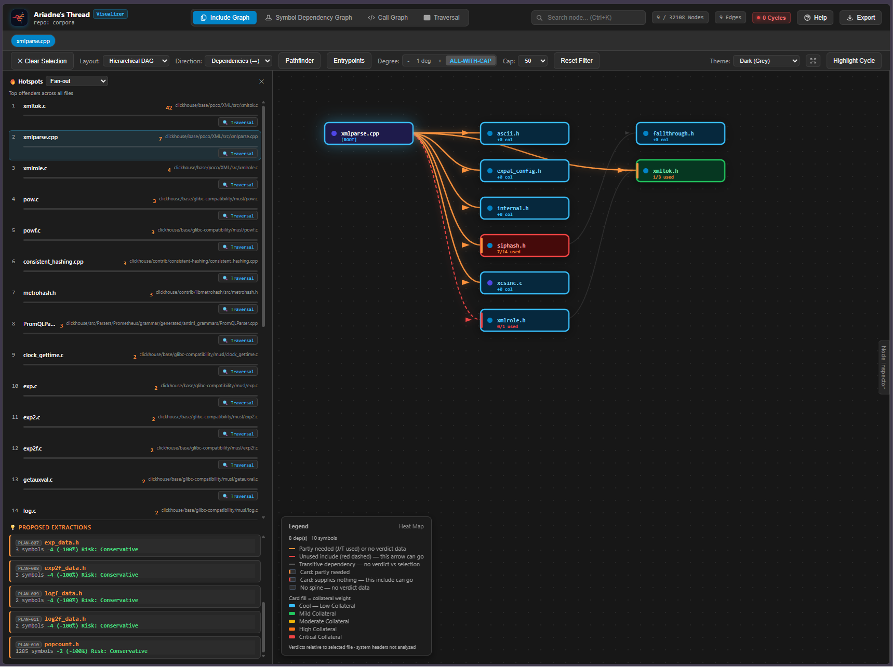
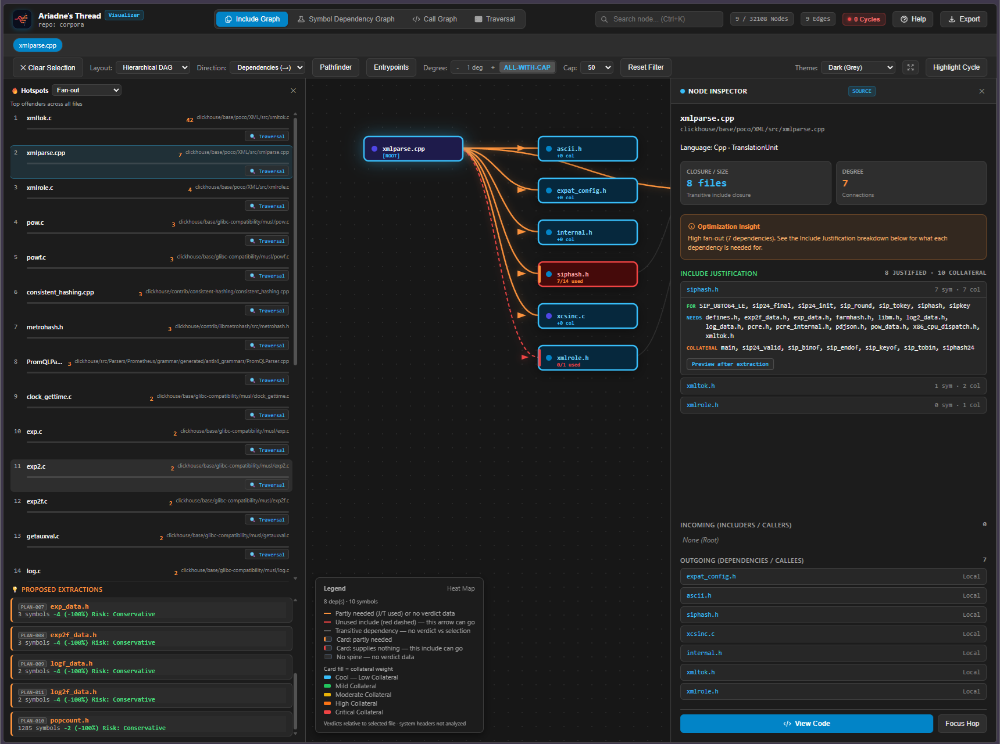

# Ariadne's Thread

Ariadne's Thread (AT) is a dependency analyzer and safe refactoring tool for large C++ codebases. It finds the dependencies your code doesn't actually need, shows where the extra compile cost comes from, and helps you separate them at safe boundaries - then checks that the result still compiles correctly and costs less to build.

## The Problem

In a big C++ codebase, a translation unit usually pays for far more code than it uses. One header pulls in another, that one pulls in a giant third-party SDK, and suddenly a file that needs 17 symbols is processing 4,382. AT calls the extra weight collateral load, and it's what makes builds crawl.

The question worth asking isn't "this header is huge." It's: what does this symbol actually require, what does the current header structure drag in on top of that, and where can the two be separated? That's what AT answers, per symbol and per file, with evidence you can check.

## How It Works

AT reasons about two separate graphs and the mapping between them:

- **Semantic graph** (symbol to symbol): what C++ semantics genuinely require - inheritance, by-value members, complete types, inline and template bodies.
- **Include graph** (file to file): what each `#include` makes the compiler physically process.
- **File/symbol mapping**: the bridge that lets AT tell the difference between "required load" and "collateral load."

From there, the loop is:

```text
Discover -> Analyze -> Explain -> Find collateral load
    -> Locate the optimization frontier -> Plan -> Apply
    -> Validate -> Measure -> Commit or roll back
```

The **optimization frontier** is where AT is allowed to make changes: your own code, sitting just before third-party, toolchain, generated, or frozen dependencies. AT won't rewrite your vendor's SDK - it restructures your code so consumers stop inheriting the SDK's cost.

Anything AT can't prove safe - templates, ODR constraints, macros, registration side effects, source-order dependencies - stays a recommendation instead of an automatic change.

## The Visualizer

AT ships with an interactive web UI: include graphs, symbol dependency graphs, call graphs, and traversal views, with collateral load heat-mapped onto the graph.

Here's one translation unit's fan-out. Each dependency is colored by how much of it is actually used. The hotspots panel ranks the worst offenders, and the Proposed Extractions list holds header splits ready to apply:



Click a node and the inspector shows AT's reasoning: which includes are justified (and the symbols that need them), which are collateral, and what the load would look like after extraction:



Also in the box: three themes (light, dark, and dark steampunk), live repo watching, search, pathfinding, cycle detection, and standalone HTML export.

## Quick Start

Requirements: a recent stable Rust toolchain.

```bash
cargo build --release
```

Point the tool at a repository and bring up the visualizer:

```bash
cargo run --release --bin tool -- ui /path/to/repo
```

The UI runs at `http://localhost:7742` and updates itself as you edit files. Build in release mode for real work - debug indexing is about 20x slower.

## VS Code Integration

A companion VS Code extension (`extensions/ariadne-extension`, MIT licensed) brings AT into your editor. It talks to the same local analysis server, so navigation and graphs stay in sync with what you see in the browser:

- **Start/Stop Ariadne Server from the Command Palette** - launches `tool ui` against your open workspace root; no terminal needed. If no binary is found, it offers to build one for you.
- **Ariadne Hotspots view** - the top dependency offenders from your repo, right in the Explorer sidebar.
- **Go to Definition / Navigate to File** - jump from any symbol or file in the analysis straight to the source in your editor.
- **Show Dependency Graph** - pops open the interactive graph viewer for the current repo.

The extension expects the server to run on the same machine, so paths line up and navigation works out of the box. Configuration is minimal: `ariadne.serverUrl` (default `http://localhost:7742`), `ariadne.toolPath` (auto-detected when empty), and `ariadne.autoConnect`. See the [extension README](extensions/ariadne-extension/README.md) for details.

## The CLI Workflow

The `tool` binary walks you through the whole loop:

| Step | Command | What it does |
|------|---------|--------------|
| 1 | `tool discover <repo>` | Find source files |
| 2 | `tool build discover <repo>` | Discover real compilation contexts and translation units |
| 3 | `tool index <repo>` | Build the semantic index (C++ today; Scala plugin included) |
| 4 | `tool analyze <repo>` / `tool explain load ...` | Measure required vs. collateral load per symbol or file |
| 5 | `tool includes explain <file>` | Explain a file's include tree and why each edge exists |
| 6 | `tool plan <repo>` | Generate header-extraction optimization plans |
| 7 | `tool transform extract` / `tool apply` / `tool migrate` | Apply a plan, optionally migrating consumers; old headers can stay as compatibility shims |
| 8 | `tool measure` / `tool compare` | Measure build cost before and after, and check the delta |
| - | `tool optimize <repo>` | Run the pipeline end-to-end |

## Multi-Language by Design

The analyzer core is language-agnostic. Language front-ends are registered plugins - C++ ships complete, a Scala plugin is included in the workspace, and more can follow the same `lang-api` contract.

## Repository Layout

- `crates/` - the Rust workspace: `cli`, `lang-api`/`lang-cpp`/`lang-scala`, `repo`, `build`, `scheduler`, `index`, `graph`, `cluster`, `transform`, `validate`, `report`, `pipeline`, `ui`
- `tools/clang-worker` - clang-backed extraction worker
- `tests/` - integration tests, including `tests/integration/`
- `Intent.md` / `Spec.md` / `Plan.md` - why the tool exists, its architecture, and the roadmap
- `docs/specs/` - per-feature specifications

## What Success Looks Like

The bar isn't "we split a big header into smaller files." It's a measured drop in compile load, separated at a boundary you chose, with the build validated and consumers migrated.

## Development

Tests run with `cargo test`; the canonical one-line summary comes from `python tools/testrun.py [args]`. CI enforces an encoding guard (`python tools/encoding_guard.py --all`) and hygiene checks (`python tools/hygiene_check.py`: functions under 100 lines, files under 1000).

## License

This project is licensed under the MIT License. See [LICENSE](LICENSE) for details.
